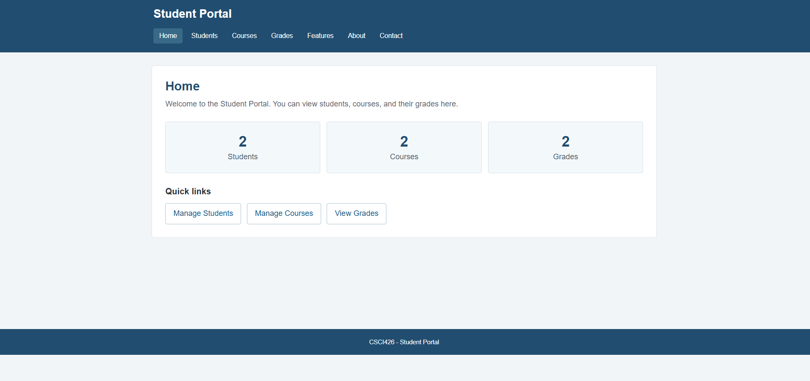
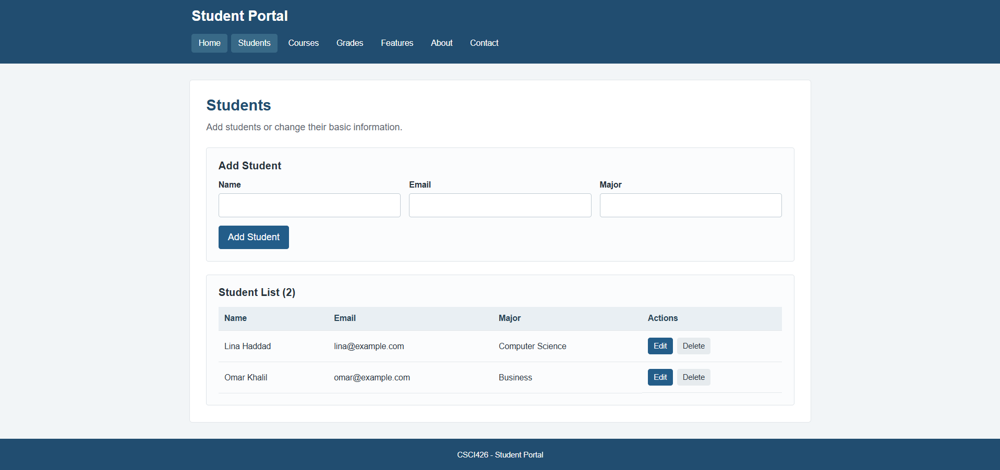
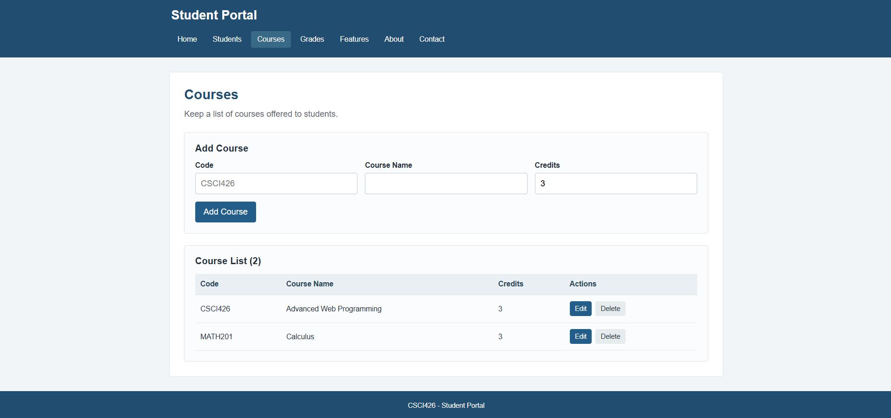
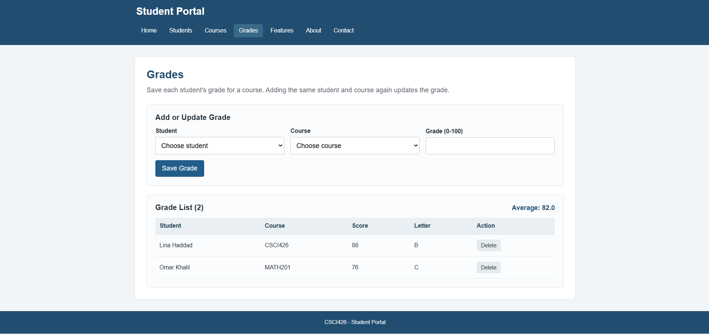
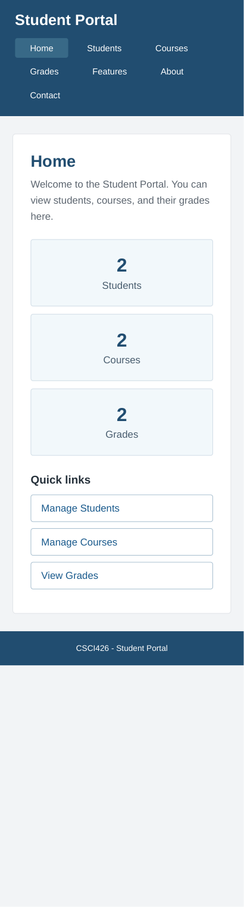

# Student Portal

CSCI426 - Advanced Web Programming, Project Phase 1

**Student:** Mohammad Al Alem  
**Student ID:** 12233093

## Description

Student Portal is a React web application for managing students, courses and grades. It contains seven pages: Home, Students, Courses, Grades, Features, About and Contact.

- **Home:** Shows the total number of students, courses and grades.
- **Students:** Add, edit and delete student records.
- **Courses:** Add, edit and delete courses.
- **Grades:** Add or update student grades, view letter grades and calculate the average.
- **Features, About and Contact:** Information about the application and a contact form interface.

Records are saved in the browser using `localStorage`. Removing a student or course also removes the grades associated with it. The application is frontend only; it does not have user accounts, a backend database or email delivery.

## Technologies

React, JavaScript (JSX), React Router, CSS and browser localStorage.

## Running the project

Node.js and npm are required.

```bash
npm install
npm start
```

The local development server normally runs at `http://localhost:3000`.

For a production build:

```bash
npm run build
```

## Project structure

- `src/App.jsx` - Routes, state and student/course/grade functions
- `src/App.css` - All styling, organized by section
- `src/pages/` - Page components
- `src/components/` - Navbar and footer
- `src/index.js` - Application entry point
- `public/` - Public files and hosting redirect rule
- `screenshots/` - Website screenshots
- `report/` - Project report

## Screenshots

### Home


### Students


### Courses


### Grades


### Mobile


## Report

[Student Portal - Project 1 Report](report/Project%201%20Report.pdf)
